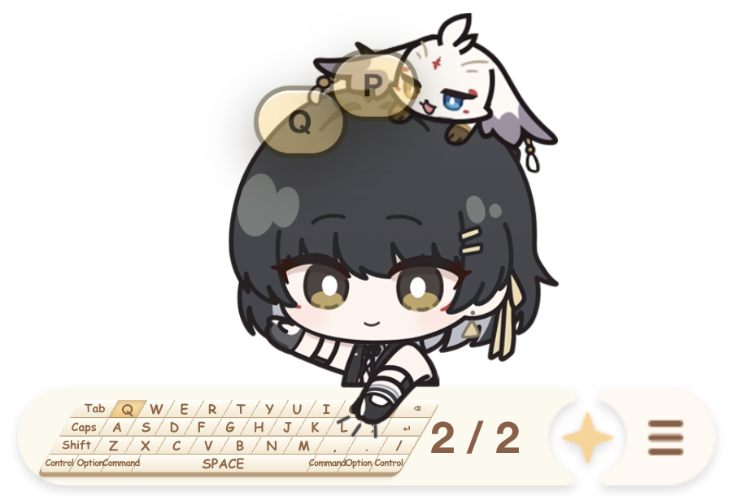
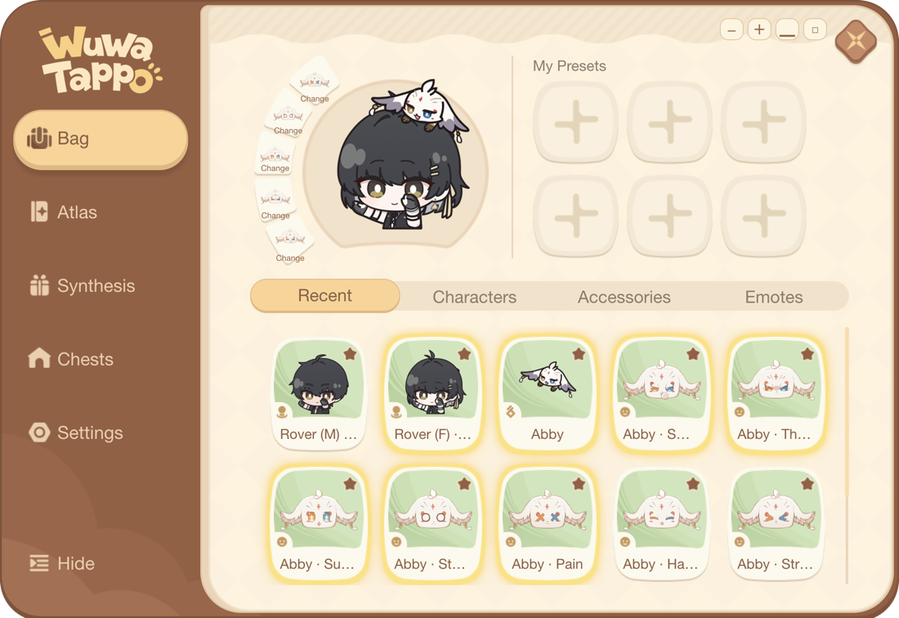
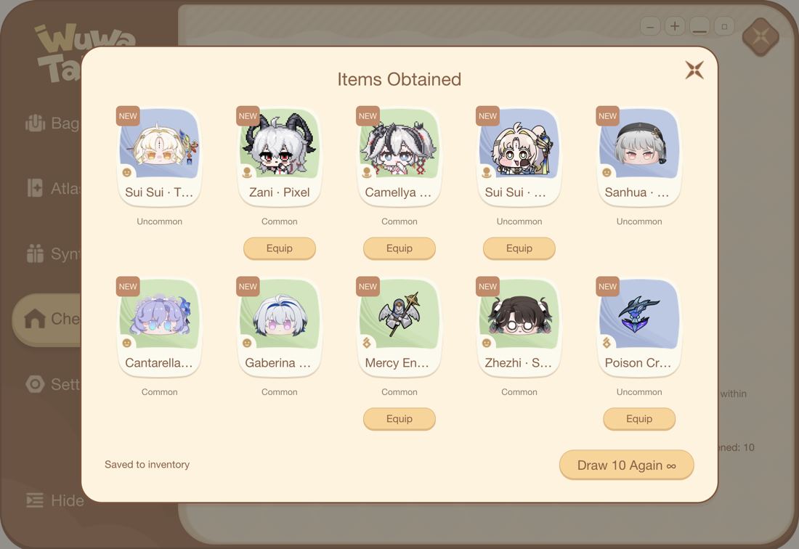
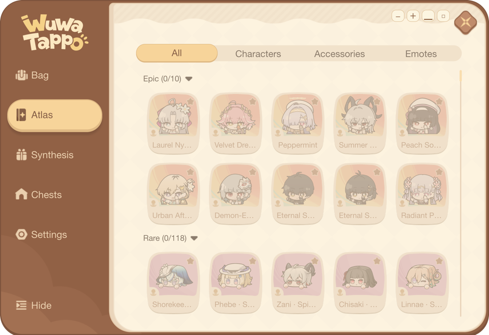
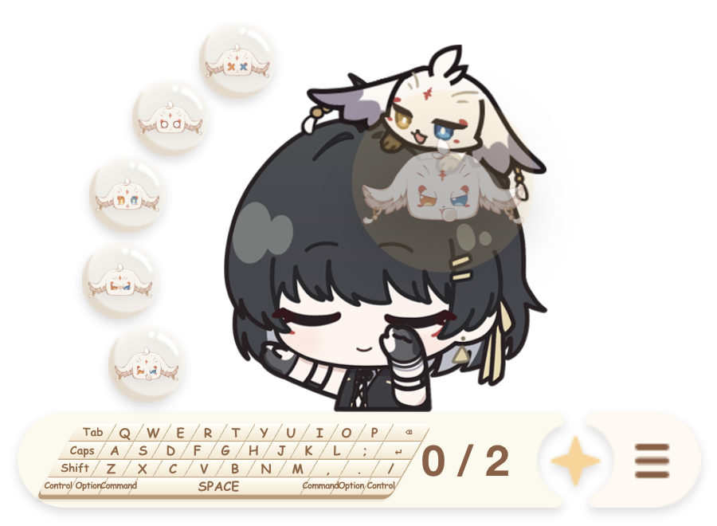

<div align="center">


# 🐾 Wuwa Tappo

**A desktop companion that taps along with every key you press.**

Inspired by the Wuthering Waves desktop pet: a floating pet, a keyboard that lights up as you type,
chests to open, outfits to collect.

[](https://github.com/AsakiYuki/wuwa-tappo/releases/latest)
[](LICENSE)




</div>

---

## 📸 Preview

<table>
  <tr>
    <td align="center" width="50%"><br /><sub>🎒 <b>Bag</b>: outfit, emote slots and presets</sub></td>
    <td align="center" width="50%"><br /><sub>🎁 <b>Chests</b>: ten draws at once</sub></td>
  </tr>
  <tr>
    <td align="center"><br /><sub>📖 <b>Atlas</b>: every item, by rarity</sub></td>
    <td align="center"><br /><sub>😆 <b>Emotes</b>: hover the pet, pick one</sub></td>
  </tr>
</table>

## ✨ Features

| | |
| --- | --- |
| 🐱 **Floating pet** | Transparent, always on top, draggable, remembers where you left it |
| ⌨️ **Live keyboard** | Every key, mouse click and controller button taps the pet and lights up its keyboard |
| 🎁 **Chest draws** | Unlimited chests with pity tracking and pull history |
| 👗 **Collection** | Characters, accessories and emotes; preview outfits and save presets |
| ⚗️ **Synthesis** | Trade 5 duplicates for a new item, or 10 for one of the next rarity |
| 😆 **Emotes** | Pick from the emote menu, or press `Ctrl`+`Alt`+`1`…`5` (`Control`+`Option` on macOS) |
| 👻 **Mouse passthrough** | Click straight through the pet; it fades when the cursor is over it |
| 🎮 **Controllers** | XInput on Windows, IOKit on macOS, evdev on Linux |
| 🖥️ **Multi-monitor** | Cycle the pet between screens |

## 📥 Download

Grab the package for your system from the **[latest release](https://github.com/AsakiYuki/wuwa-tappo/releases/latest)**:

| OS | Package |
| --- | --- |
| 🪟 Windows 10/11 | `wuwa-tappo-<version>-x64-setup.exe` |
| 🍎 macOS 10.15+ | `wuwa-tappo-<version>-arm64.dmg` (Apple Silicon) · `-x64.dmg` (Intel) |
| 🐧 Linux | `.AppImage` · `.deb` · `.rpm` |
| ❄️ NixOS | `nix run github:AsakiYuki/wuwa-tappo` (see [NixOS](#nixos)) |

> [!NOTE]
> **macOS:** the app is not notarized. The first time, right-click it and choose **Open**, or run
> `xattr -cr "/Applications/Wuwa Tappo.app"`.

## 🔐 Permissions

The pet reacts to keys typed into *any* window, so it needs to see global input:

- 🪟 **Windows:** nothing to set up.
- 🍎 **macOS:** allow **Input Monitoring** (System Settings → Privacy & Security → Input Monitoring).
  macOS asks on first launch; while it's missing, the tray menu has a shortcut to that page.
  Restart the app after granting it.
- 🐧 **Linux (X11):** nothing to set up.
- 🐧 **Linux (Wayland):** Wayland hides other windows' key presses, so the pet reads
  `/dev/input/event*` directly. Use the tray's **⚡ Fix Input Permissions** (until reboot) or
  `./fix-permissions.sh`, which can also install
  [`70-wuwa-tappo-input.rules`](packaging/linux/70-wuwa-tappo-input.rules) permanently.

> [!WARNING]
> On Linux, read access to `/dev/input` lets **every** program you run read raw keystrokes, not
> only Wuwa Tappo. Weigh that before enabling it.

## 🐧 Linux notes

- 🪟 **Native Wayland:** where the compositor supports wlr-layer-shell (KDE Plasma, Hyprland,
  Sway, …) the pet stays above windows and out of the taskbar. On GNOME it is a normal window.
- 🔷 **KDE Plasma 5/6:** hover-fade with passthrough works through a small KWin script.
- 👣 **GNOME:** the tray icon needs the *AppIndicator and KStatusNotifierItem Support* extension.

<a id="nixos"></a>

## ❄️ NixOS / Nix

Run it without installing:

```bash
nix run github:AsakiYuki/wuwa-tappo
```

Or install it system-wide with the NixOS module:

```nix
# flake.nix
{
  inputs.wuwa-tappo.url = "github:AsakiYuki/wuwa-tappo";

  outputs = { nixpkgs, wuwa-tappo, ... }: {
    nixosConfigurations.my-host = nixpkgs.lib.nixosSystem {
      modules = [
        wuwa-tappo.nixosModules.default
        {
          programs.wuwa-tappo.enable = true;
          # Global input on Wayland (see the warning above):
          programs.wuwa-tappo.inputAccess = true;
        }
      ];
    };
  };
}
```

For Home Manager or a plain profile, add `wuwa-tappo.overlays.default` and install
`pkgs.wuwa-tappo`, or use `wuwa-tappo.packages.${system}.default` directly.

## 🛠️ Development

**You need:** [Node.js](https://nodejs.org) 18+ (or [Bun](https://bun.sh)) and
[Rust](https://rustup.rs).

<details>
<summary>📦 Per-OS build dependencies</summary>

- 🪟 **Windows:** the MSVC C++ build tools, or the GNU toolchain with MinGW
  (`rustup toolchain install stable-x86_64-pc-windows-gnu` and `scoop install mingw`);
  `bun start` picks whichever is installed.
- 🍎 **macOS:** the Xcode command line tools (`xcode-select --install`).
- 🐧 **Linux:** `libwebkit2gtk-4.1-dev libayatana-appindicator3-dev librsvg2-dev libx11-dev libxtst-dev libxi-dev libgtk-layer-shell-dev`
- ❄️ **NixOS:** nothing. `bun start` enters `shell.nix` on its own, which has Rust and every library.

</details>

```bash
npm install
npm start          # or: bun start
```

`npm start` builds the renderer and runs the app on every OS.

| Command | What it does |
| --- | --- |
| `npm start` | ▶️ Run the app |
| `npm start -- --x11` | 🐧 Run through XWayland instead of native Wayland |
| `npm test` | 🧪 Test the game logic |
| `npm run build` | 📦 Package the app for this OS |

> [!TIP]
> During development, macOS asks for Input Monitoring for your **terminal**, not for the app.

### 🚀 Releasing

Bump `version` in `package.json`, then push a matching tag:

```bash
git tag v1.0.9 && git push origin v1.0.9
```

The **Release** workflow builds Windows, Linux and macOS (arm64 + x64) and puts every package on one
GitHub release.

## 🧩 How it fits together

```text
src/
├── renderer/     🎨 Vue 3 pages: the pet and the studio
├── domain/       🎲 Game logic: draws, pity, synthesis, presets
├── backend/      🔌 Entry point the app runs the game logic through
└── native/       🎮 Controller watchers (XInput, IOKit)
src-tauri/        🦀 The Tauri app: windows, input, tray, saving
assets/           🖼️ Characters, accessories, emotes, catalog
```

The game logic is TypeScript, bundled into one script that the Rust side runs in QuickJS. Your
collection is saved in `collection.json`. More in [src-tauri/README.md](src-tauri/README.md).

## 📜 License

[MIT](LICENSE) 💛
